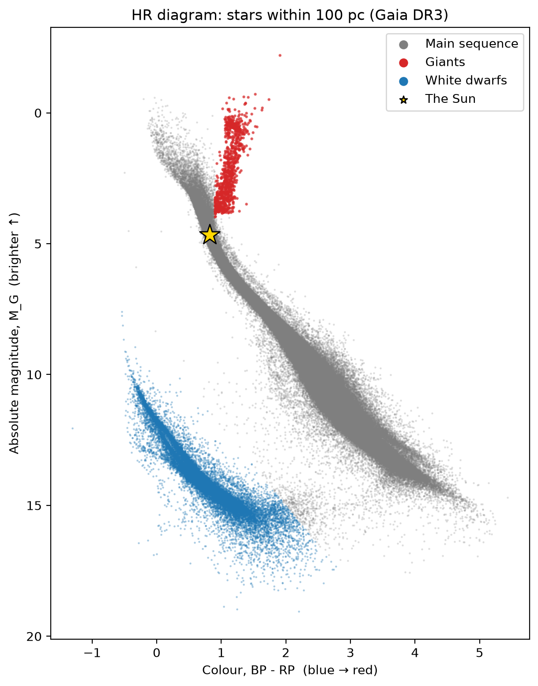

# Gaia HR Diagram

A Hertzsprung–Russell (HR) diagram of stars within 100 parsecs of the Sun, built from ESA Gaia DR3 data.



## What is an HR diagram?

An HR diagram plots stars by their colour (which tells you temperature) against their true brightness (absolute magnitude). Stars at different stages of life land in different regions, so one plot shows how stars are born, live and die.

## Data

The data comes from the [Gaia Archive](https://gea.esac.esa.int/archive/) (Gaia DR3), using this ADQL query:

```sql
SELECT source_id, ra, dec, parallax, parallax_over_error,
       phot_g_mean_mag, phot_bp_mean_mag, phot_rp_mean_mag, bp_rp, ruwe
FROM gaiadr3.gaia_source
WHERE parallax > 10
  AND parallax_over_error > 10
  AND phot_bp_mean_flux_over_error > 10
  AND phot_rp_mean_flux_over_error > 10
  AND ruwe < 1.4
```

- `parallax > 10` keeps stars within 100 parsecs.
- The other conditions keep only stars with precise distance and colour measurements.

The query returns 228623 stars. The data is saved in `data/raw/gaia_dr3_100pc.csv`.

## Method

1. Calculate absolute magnitude from apparent magnitude and parallax:
   `M_G = phot_g_mean_mag + 5 * log10(parallax) - 10`
2. Plot colour (`bp_rp`) against `M_G`, with the y-axis flipped so bright stars are at the top.
3. Split the stars into main sequence, giants and white dwarfs using simple cut lines, and mark the Sun.

All the code is in `notebooks/hr_diagram.ipynb`.

## What I found

- **Main sequence:** the thick diagonal band of stars fusing hydrogen. Most stars near the Sun are small red dwarfs at its lower end.
- **White dwarfs:** a separate strip at the bottom left, the hot, faint remains of Sun-like stars.
- **Giants and the red clump:** a small group at the top right. Giants are rare, so few are within 100 parsecs.
- **The Sun** sits on the main sequence as an ordinary middle-aged star.
- **Binary stars** form a faint second ridge just above the main sequence.

## Limitations

- The region boundaries are simple straight cuts. In reality stars change gradually between stages.
- Very faint stars have less reliable colours, which causes a smear at the bottom of the diagram.

## How to run it

```
python -m venv .venv
.venv\Scripts\Activate.ps1
pip install -r requirements.txt
```

Then open `notebooks/hr_diagram.ipynb` and run all cells.

## Credits

This work uses data from the European Space Agency (ESA) mission Gaia (DR3), processed by the Gaia Data Processing and Analysis Consortium (DPAC).
